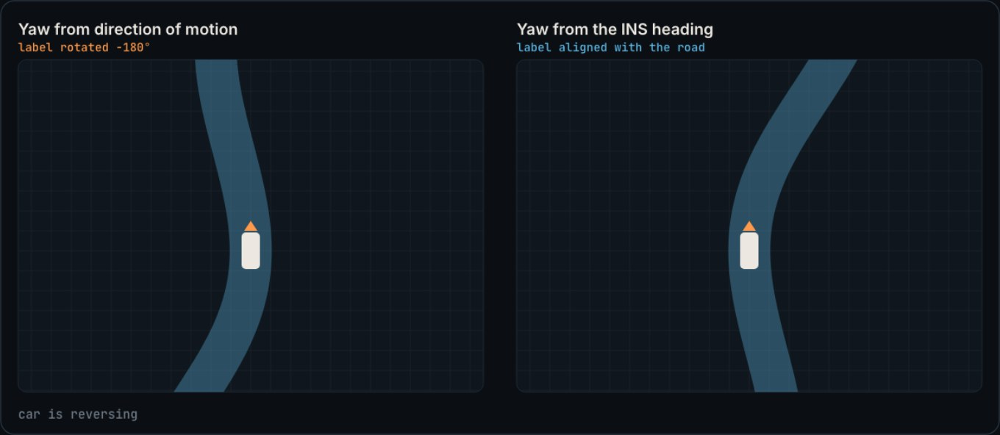

## Question

We adapted BEVFusion, a model that fuses six cameras and a LiDAR into a bird's-eye-view map, to recordings from Vietnamese roads. After converting the data into the nuScenes format, validation accuracy stalled at a level that looked like the limit of the architecture. Before changing the model, we wanted to know whether the labels were telling it the truth.

## My role

I was the technical lead of a five-person team and owned benchmarking and runtime measurement. The diagnosis below was a team effort, so I write it as “we”.

## A decision: suspect the pose before the model

There were two reasonable next steps: tune the network, or audit how each label was placed. Map labels are drawn around the car using its recorded heading, so a wrong heading rotates the whole label. The recorded heading turned out to be the direction of motion, not the direction the car was facing. It read zero whenever the car stopped and pointed backwards whenever the car reversed. A gyroscope reading confirmed the car's body was not actually turning in those moments. The fix was to take heading from the inertial navigation system and fall back to the last valid value.

<figure><figcaption>The same drive seen two ways. Left: yaw taken from the direction of motion. When the car stops, the yaw snaps to a fixed value; when it reverses, it flips by 180°, and the road label rotates with it. Right: yaw from the inertial heading keeps the label on the road.</figcaption></figure>

## Evidence

With the same configuration, the same random seed and the same validation frames, retraining on corrected labels raised mean intersection-over-union from about 0.40 to about 0.74. The label pixels themselves barely changed, which rules out a different dataset as the explanation.

## Limits and next test

Training and validation came from the same recording, so this measures in-domain accuracy, not generalisation to new roads. The model also runs well above the latency target. The next test is a validation split taken from a different drive.
