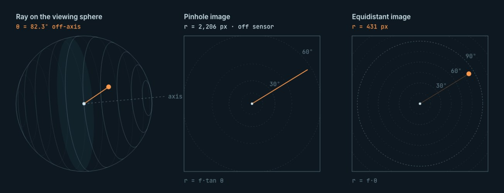

A fisheye lens bends a whole hemisphere, sometimes more, onto one flat sensor. To get depth out of such an image you first need a rule that says which direction in the world each pixel looks at. That rule is the camera model, and the familiar one stops working at the edge of the picture.

## The pinhole rule, and where it ends

A pinhole camera maps a ray that makes angle $$\theta$$ with the optical axis to a point at distance

$$
r = f \tan\theta
$$

from the image centre, where $$f$$ is the focal length in pixels. With $$f = 300$$ px, a ray at 45° lands at 300 px. At 80° it lands at about 1,700 px. At 90° it would land at infinity. A pinhole image can never show anything at or beyond 90° off-axis, however large the sensor.

## The equidistant rule

Many fisheye lenses follow, approximately, the equidistant model:

$$
r = f\,\theta
$$

Distance from the centre grows *linearly* with angle. With the same $$f = 300$$ px, 45° lands at 236 px, 90° at 471 px, and 97.5° (the edge of a 195° lens) at 511 px. Nothing runs off to infinity, so the whole field of view fits on the sensor. The price is that straight lines in the world bend in the image, which is the familiar fisheye look.

| Angle off-axis | Pinhole $$f\tan\theta$$ | Equidistant $$f\theta$$ |
| --- | --- | --- |
| 30° | 173 px | 157 px |
| 60° | 520 px | 314 px |
| 80° | 1,701 px | 419 px |
| 90° | ∞ | 471 px |

Real lenses drift from the ideal, so calibration fits a few extra polynomial terms in $$\theta$$. The idea stays the same: radius as a function of angle.

<figure><figcaption>One ray at 82.3° off the optical axis, imaged by two models on the same sensor (f = 300 px, half-width 511 px). The pinhole model puts it at about 2,200 px, far off the sensor; past 90° it has no image point at all. The equidistant model puts it at 431 px, inside the sensor.</figcaption></figure>



## Why this matters for depth

Stereo depth comes from the angle between two views of the same point. The usual pipeline cuts a fisheye image into pinhole views, because standard stereo matchers expect pinhole geometry. By the table above, each pinhole view can only use a cone well under 90°, so the widest part of the image, often where two cameras overlap most, gets thrown away.

Matching on the fisheye geometry directly keeps those pixels.

In a later post I will look at calibration: why a rotation error of a tenth of a degree between cameras matters more than you would expect at long range.
